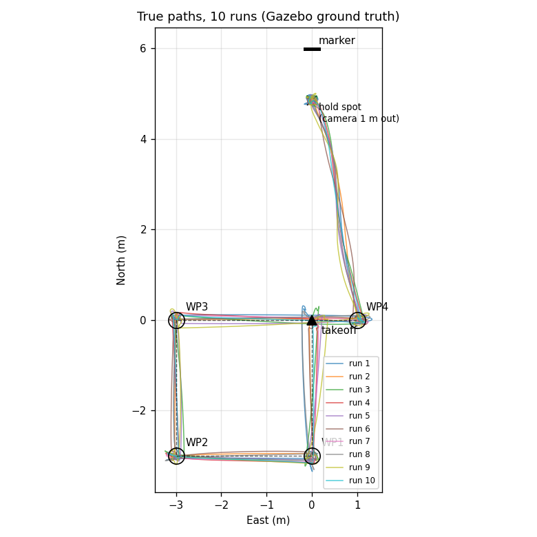

# Drone_Navigation: waypoints + ArUco marker arrival

A quadcopter takes off, flies 3-4 waypoints, searches for a printed ArUco marker, flies to 1 m in
front of it, holds there for 5 s and lands. Phase 1 (this repo) is simulation; phase 2 runs the
same ROS 2 nodes on the real T27 drone (see [docs/real_drone.md](docs/real_drone.md)).

The sim matches the T27's flight software: **ArduCopter 4.6.3** (not PX4), controlled through
**MAVROS on ROS 2**, with a fixed forward camera like its Pi Camera 3 Wide.

| Piece | Version | Location |
| --- | --- | --- |
| Ubuntu | 26.04 | |
| ROS 2 | Lyrical | `/opt/ros/lyrical` |
| Gazebo | Jetty (from ROS `ros_gz` vendor packages) | |
| ArduPilot SITL | Copter-4.6.3 | `~/ardupilot` |
| ArduPilot Gazebo plugin | pinned commit | `~/ardupilot_gazebo` |
| This project's ROS 2 code | | `ros2_ws/src/drone_mission` |

## Quick demo

Run everything from this folder (`cd ~/Projects/Robotics/Drone_Navigation`).

```bash
scripts/start_sim.sh                       # terminal 1: wait for READY, leave it open
```

```bash
source setup/env.sh
ros2 run rqt_image_view rqt_image_view /camera/image     # terminal 2 (optional): drone's camera
```

```bash
source setup/env.sh
ros2 run drone_mission mission             # terminal 3: the full mission (~70 s)
```

Ctrl-C in terminal 1 stops the sim. Closing the Gazebo window also stops it.

## One-time setup

On a fresh Ubuntu 26.04 machine, clone this repo, then:

```bash
setup/01_install_system.sh   # downloads ArduPilot + plugin, installs ROS 2 etc.; needs sudo; ~20-40 min
setup/02_build_sim.sh        # no sudo; ~15-30 min
```

With Claude Code on that machine, open this folder and ask it to "set up this project".
`CLAUDE.md` tells it the steps and the problems hit on the first machine.

## The sim

```bash
scripts/start_sim.sh                 # Gazebo window + ArduPilot SITL + MAVROS + Gazebo-ROS bridge
scripts/start_sim.sh --headless      # no window (faster; the camera still renders)
scripts/start_sim.sh --noise         # GPS + barometer noise (sim/params/noise.parm)
scripts/start_sim.sh --gps-denied    # no GPS: optical flow + rangefinder, like the T27 indoors
WORLD=iris_runway.sdf scripts/start_sim.sh   # ArduPilot's original world instead
```

Options combine. Each start wipes ArduPilot's saved parameters, so options never carry over.
`start_sim.sh` refuses to start while an earlier sim is still running and prints the PIDs to
kill. Program output goes to `logs/sim_*.log`. Each piece can also run in its own terminal:
`scripts/sim_gazebo.sh`, `scripts/sim_ardupilot.sh` (MAVProxy console), `scripts/mavros.sh`,
`scripts/gz_bridge.sh`.

**World** (`sim/worlds/aruco_world.sdf`): ArduPilot's runway world plus

- **Drone `iris_fwd_cam`**: the ArduPilot Iris without its gimbal, plus a fixed camera like the
  T27's: 15 cm ahead of the IMU, 2 cm below, looking forward. 1280x720 at 15 Hz, 102° horizontal
  FOV, ideal pinhole (fx = fy = 518.4). Starts at the origin facing North.
- **Marker `aruco_marker`**: ArUco `DICT_4X4_50` id 0, 0.20 m (black border included) on a white
  board, centre 1.5 m up a post, 6 m North of the start, facing the drone.
- **Wind**: Gazebo's WindEffects plugin, off by default. Set it while running:
  `gz topic -t /world/aruco_world/wind -m gz.msgs.Wind -p 'linear_velocity: {x: 3, y: 0}, enable_wind: true'`
  (blows toward +x = East at 3 m/s; the plugin adds gusts and direction swings). At 4.5 m/s the
  drone leans ~4° into it.
- **Ground truth**: PosePublisher plugins on the drone and marker, bridged to ROS as
  `/ground_truth/drone` (50 Hz) and `/ground_truth/marker`.

**ROS topics from the bridge**: `/camera/image`, `/camera/camera_info`, `/ground_truth/drone`,
`/ground_truth/marker`. Camera tools:

```bash
python3 sim/tools/check_marker.py          # grab a frame, detect the marker, print the solvePnP pose
python3 sim/tools/make_marker.py --id 0    # regenerate (and print, at 0.20 m) the marker
```

**Speed**: headless runs at real time. With the Gazebo window on a laptop iGPU it can drop to
~0.3x; the nodes multiply their timeouts by `timeout_scale` (default 4) for that, and the
experiment uses 1.0 headless.

## The nodes

All in `ros2_ws/src/drone_mission/drone_mission`, run as `ros2 run drone_mission <node>`.

| Node | Does |
| --- | --- |
| `mission` | **The full project**: take off, waypoints, search, marker approach, 5 s hold, land |
| `waypoint_navigator` | Waypoints only, then land |
| `marker_approach` | Take off, search, approach, hold, land |
| `hello_flight` | Smoke test: take off, fly 3 m East, land |

Shared code: `flight_base.py` (MAVROS connection, GUIDED, arming, takeoff, position and velocity
setpoints, landing, abort-to-LAND on errors, pilot-takeover detection, run logging) and
`marker_tracker.py` (ArUco detection and pose). Settings are ROS parameters; the demo values are in
`config/mission.yaml`:

```bash
ros2 run drone_mission mission --ros-args --params-file ros2_ws/src/drone_mission/config/mission.yaml
ros2 run drone_mission mission --ros-args -p waypoints:="[3.0,0.0,2.0, 3.0,-3.0,2.0, 0.0,0.0,1.5]"
```

**Coordinates**: waypoints are metres from the takeoff spot, x = East, y = North, z = height, as a
flat list `[x1, y1, z1, x2, y2, z2, ...]`. (MAVROS's own local frame is anchored where ArduPilot
first got a position fix and doesn't reset between flights, so the nodes record the takeoff spot
and add it on.) The default route is a loop to the South-West that ends 1 m East of the start,
heading East, with the marker out of view, so the search always runs.

**Waypoints**: turn to face the next waypoint, stream position setpoints at 10 Hz until within
`tolerance` (arrived), keep hovering until settled within `settle_tolerance`, hover
`waypoint_hold` s, next. ArduPilot overshoots a 3-4 m step by 10-20 cm and settles back in 2-4 s;
without the settle step a 2 s hold ends right at the overshoot peak.

**Marker approach** (proportional control, velocity setpoints at 10 Hz):

- *search*: yaw in place at `search_rate_deg` until the camera sees the marker (gives up after
  one full turn and lands)
- *approach*: yaw rate from the bearing to the marker (keeps it centred), climb rate from the
  height difference, horizontal velocity toward the spot `target_range` out along the marker's
  normal (closes the range and squares the drone up to the marker). Speed capped at `max_speed`.
- *final metres*: within `fine_radius` (0.3 m) of that spot it switches to position targets: the
  spot itself, recomputed from the marker estimate every frame, yawed at the marker centre.
  ArduPilot's own position controller (with its integrators) then fights the wind; the slow outer
  P loop alone could not hold ±0.10 m in gusts (3/10 runs in the first experiment, below).
- *hold*: starts once every error is within `entry_fraction` (half) of its tolerance, then counts
  while they stay within the full tolerance with a fresh detection; leaving it restarts the 5 s.
- If the marker drops out the drone stops and keeps facing where it was; after `lost_timeout` s
  it lands.

How the marker pose is built: `solvePnP` (IPPE_SQUARE) gives the marker in the camera frame; the
camera mount and the drone's attitude from MAVROS turn it into the world frame; since the marker
is static, its world position and facing direction are low-pass filtered across frames, which
cancels camera tilt while the drone accelerates and rides through dropped frames. The facing
direction is only good to a few degrees at 4-6 m (tens of cm of apparent sideways offset), so
the sideways correction fades in within 2 m. Fisheye calibrations (`equidistant`) are handled.

| Parameter | Default | Meaning |
| --- | --- | --- |
| `waypoints` | route above | flat list of x, y, z triples (m) |
| `tolerance` | 0.3 | m (3D) that counts as reaching a waypoint |
| `waypoint_hold` | 2.0 | s to hover at each waypoint, once settled |
| `settle_tolerance` / `settle_timeout` | 0.10 / 10 | m to settle within before the hold counts (ArduPilot overshoots 10-20 cm), max s |
| `takeoff_altitude` | 2.0 (`marker_approach`: 1.5) | m |
| `face_travel` | true | yaw toward the next waypoint before each leg |
| `target_range` | 1.0 | m from the marker plane to the camera (min 0.5) |
| `hold_time` | 5.0 | s in tolerance at the marker |
| `range_tol` / `lateral_tol` / `height_tol` | 0.10 / 0.15 / 0.10 | m |
| `bearing_tol_deg` | 5.0 | deg |
| `entry_fraction` | 0.5 | fraction of the tolerances needed to start the hold |
| `marker_id` / `marker_size` | 0 / 0.20 | id (-1 = any) and side in m |
| `max_speed` / `max_climb` / `max_yaw_rate_deg` | 0.5 / 0.3 / 30 | m/s, m/s, deg/s |
| `k_pos` / `k_z` / `k_yaw` | 0.5 / 0.8 / 1.0 | proportional gains |
| `search_rate_deg` | 20 | deg/s, + = counter-clockwise |
| `lost_timeout` | 10 | s without a detection before landing |
| `fine_radius` | 0.3 | m from the hold spot where it switches to position targets (0 = P velocity only) |
| `image_reliable` | true | reliable QoS for the camera (false if a driver only publishes best-effort) |
| `image_topic` / `camera_info_topic` | `/camera/image` / `/camera/camera_info` | camera topics (real drone: `/camera/image_raw`) |
| `camera_offset` | [0.15, 0.0, -0.02] | camera position from the IMU, m (forward, left, up) |
| `timeout_scale` | 4.0 | multiplies waits; 1.0 headless |
| `log_dir` | `logs/` | where run logs go |

**Run logs**: every run writes `logs/<node>_<time>.csv` at 10 Hz (phase, waypoint, mode, the
drone's own estimate in the mission frame, Gazebo's true pose, marker errors, commanded
velocities) and `.json` (per-waypoint results, search, hold statistics, success, true marker
pose). If anything fails after arming, the node switches the drone to LAND; if the pilot changes
the flight mode, the node stops commanding and leaves the drone to the pilot.

## Experiment

```bash
python3 tools/run_experiment.py                     # 10 runs -> results/<time>/  (~17 min)
python3 tools/run_experiment.py --runs 3 --wind-max 0 --no-noise
python3 tools/analyze_experiment.py results/<time>  # re-make plots and summary
```

Each run starts a fresh headless sim with GPS/baro noise, sets a random wind (1-4 m/s, random
direction, plus gusts), flies `mission`, and stops the sim. The analysis scores every run against
Gazebo's ground truth and writes `summary.md`, `paths.png`, `hold.png`, `waypoint_errors.png` and
CSV tables.

### Results (2026-11-12)

All errors against Gazebo ground truth. Full tables and plots: `results/<name>/summary.md`.

| Experiment | Conditions | Success | Waypoint error, end of hold | Hold range (target 1.00 m) | Hold lateral | Hold bearing |
| --- | --- | --- | --- | --- | --- | --- |
| [`experiment_main`](results/experiment_main/summary.md) | GPS + noise, wind 0.5-2.5 m/s + gusts | **9/10** | 0.07-0.09 m mean (max 0.13) | 0.986 ± 0.040 m (all samples 0.90-1.08) | ±0.11 m max | ±1.7° max |
| [`experiment_gps_denied`](results/experiment_gps_denied/summary.md) | optical flow + rangefinder, no GPS, no wind | **5/5** | 0.01 m (max 0.02) | 0.989 ± 0.002 m | ±0.03 m max | ±1.3° max |
| [`experiment_p_only`](results/experiment_p_only/summary.md) | first controller (P velocity only), wind 1-4 m/s | 3/10 | (old hold timing) | 1.000 ± 0.023 m (3 successes) | | |



What the experiments showed (and what changed because of them):

- **Wind is the limit, not vision.** The marker estimate agrees with ground truth to ~1 cm (it reads
  ~1 cm long, 0.999 vs 0.989 m). With a fixed position target and no vision at all, ArduPilot's own
  position hold wanders ±0.2 m in 3.5 m/s gusts, so a ±0.10 m hold needs wind under ~2.5 m/s. The one
  failure in `experiment_main` was at 2.4 m/s; the same seed passed in an earlier run.
- **P-only velocity control was too slow for gusts** (3/10 above, all failures at ≥2.3 m/s): the
  range swung ±0.11 m and the 5 s hold kept restarting. Switching to ArduPilot position targets
  for the final 0.3 m fixed that.
- **ArduPilot overshoots a 3-4 m step by 10-20 cm** and settles back in 2-4 s, so waypoints now
  wait until the drone stays within 0.10 m for 1 s before the 2 s hold (`settle_tolerance`).
- Camera frames over best-effort DDS dropped to ~10 Hz with >1 s gaps; the tracker now uses
  reliable QoS (15 Hz, no gaps). A far, grazing detection could return NaN and freeze the
  approach; such solves are rejected now.
- GPS-denied (optical flow) navigation in the sim is as good as GPS without noise. The sim's flow
  sensor is ideal, so real flow drift (texture, light, height) will be worse; see the real-drone plan.

## Real drone

See [docs/real_drone.md](docs/real_drone.md): what the T27 has, indoor positioning, software on
the Pi, safety setup, and staged test plan. Camera calibration for the Pi Camera 3 Wide:

```bash
python3 tools/calibrate_camera.py calib_photos/ --square 0.025          # -> camera.yaml
python3 tools/calibrate_camera.py --test camera.yaml marker_1m.jpg      # range check vs tape measure
```

It fits both the standard (rational) and fisheye lens models and keeps the better one. Checked on
synthetic photos rendered through a known fisheye lens: it recovered fx = 600.0 (true 600) and
k1 = -0.051 (true -0.050), and measured a marker at 1.010 m (true 1.006 m).

## Frames

MAVROS local frame and the mission frame are ENU: x = East, y = North, z = Up. ArduPilot works in
NED; MAVROS converts. The camera's `solvePnP` output is x right, y down, z forward.
