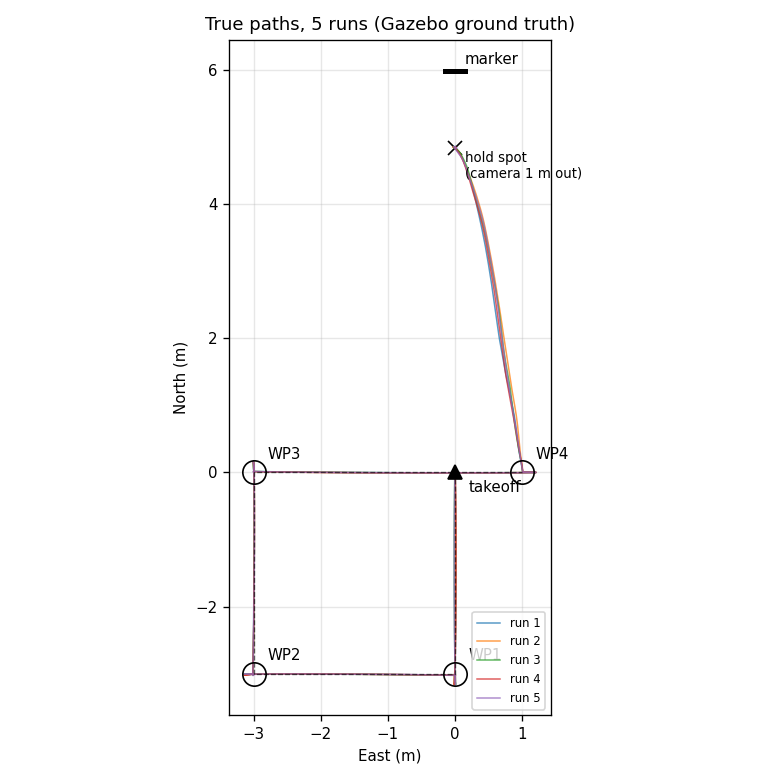
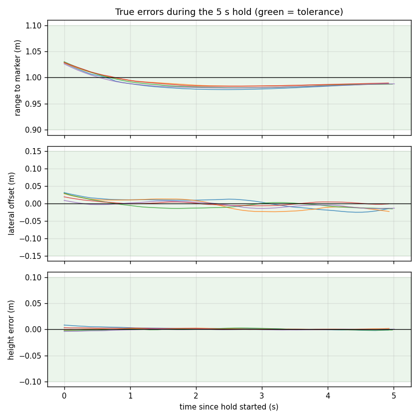
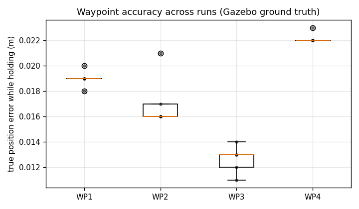

# Experiment experiment_gps_denied

5 runs of the full mission (waypoints → search → approach → 5 s hold at 1 m → land), each in a fresh headless sim. Wind 1.0–0.0 m/s random direction plus the world's gusts; GPS/baro noise on. Position from optical flow + rangefinder, no GPS (--gps-denied). Hold statistics are over each successful run's completed 5 s hold. Errors are measured against Gazebo ground truth.

**Success: 5/5**

| Run | OK | Wind | Duration (s) | Search (°) | Settle (s) | True range (m) | True lateral (m) | Note |
| --- | --- | --- | --- | --- | --- | --- | --- | --- |
| 1 | ✓ | 0.0 m/s @ -132° | 85.8 | 52.2 | 12.3 | 0.986 | +0.001 |  |
| 2 | ✓ | 0.0 m/s @ 125° | 85.8 | 51.8 | 12.4 | 0.991 | -0.003 |  |
| 3 | ✓ | 0.0 m/s @ 95° | 85.9 | 52.2 | 12.3 | 0.989 | -0.005 |  |
| 4 | ✓ | 0.0 m/s @ -88° | 84.1 | 51.4 | 12.7 | 0.991 | +0.001 |  |
| 5 | ✓ | 0.0 m/s @ -2° | 85.9 | 51.7 | 12.5 | 0.988 | -0.004 |  |

## Waypoints (true position error)

| Waypoint | Target (m) | When the hold starts (settled) | Mean over the 2 s hold | End of hold | Drone's own estimate (mean over hold) |
| --- | --- | --- | --- | --- | --- |
| WP1 | (0, -3, 2) | 0.041 ± 0.002 m (max 0.043) | 0.019 ± 0.001 m (max 0.020) | 0.013 ± 0.001 m (max 0.014) | 0.018 ± 0.001 m (max 0.019) |
| WP2 | (-3, -3, 2.5) | 0.039 ± 0.001 m (max 0.040) | 0.017 ± 0.002 m (max 0.021) | 0.011 ± 0.004 m (max 0.018) | 0.022 ± 0.001 m (max 0.022) |
| WP3 | (-3, 0, 2) | 0.034 ± 0.003 m (max 0.038) | 0.013 ± 0.001 m (max 0.014) | 0.007 ± 0.001 m (max 0.008) | 0.020 ± 0.001 m (max 0.021) |
| WP4 | (1, 0, 1.5) | 0.047 ± 0.001 m (max 0.049) | 0.022 ± 0.000 m (max 0.023) | 0.013 ± 0.001 m (max 0.014) | 0.022 ± 0.001 m (max 0.023) |

## Marker hold (true, camera to marker, mean over each run's 5 s hold)

| Quantity | Tolerance | Mean ± std across runs (worst run) | Worst single sample |
| --- | --- | --- | --- |
| Range (target 1.00 m) | ±0.10 m | 0.989 ± 0.002 m (max 0.991) | 1.028 ± 0.001 m (max 1.030) |
| Lateral offset | ±0.15 m | -0.002 ± 0.003 m (max -0.004) | 0.019 ± 0.019 m (max 0.031) |
| Height error | ±0.10 m | 0.000 ± 0.001 m (max 0.002) | 0.002 ± 0.004 m (max 0.008) |
| Bearing | ±5° | -0.24 ± 0.07 ° (max -0.31) | -0.98 ± 0.22 ° (max -1.26) |

Drone's own range estimate during the hold: 0.999 ± 0.002 m (max 1.001) (vs true 0.989 ± 0.002 m (max 0.991)). Time from first sighting to settled: 12.4 ± 0.2 s (max 12.7). Hold restarts: 0.

