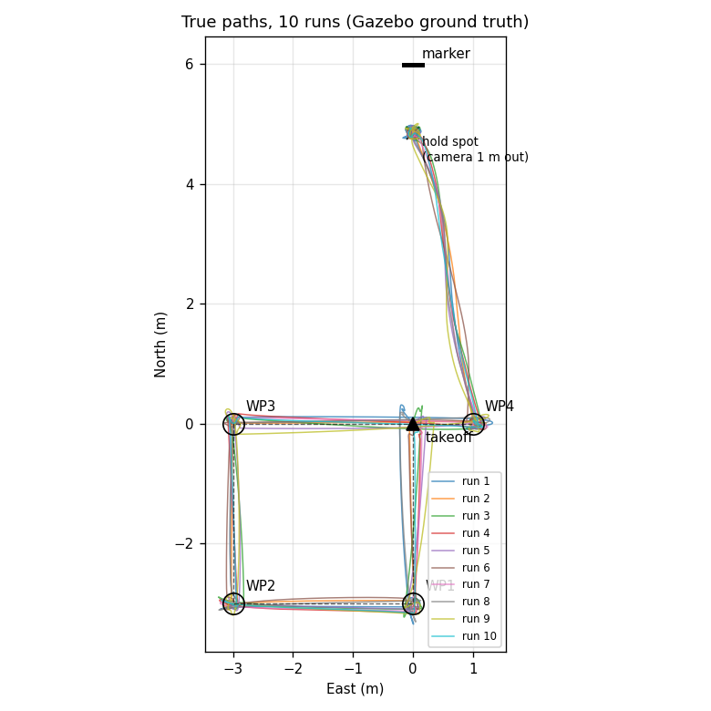
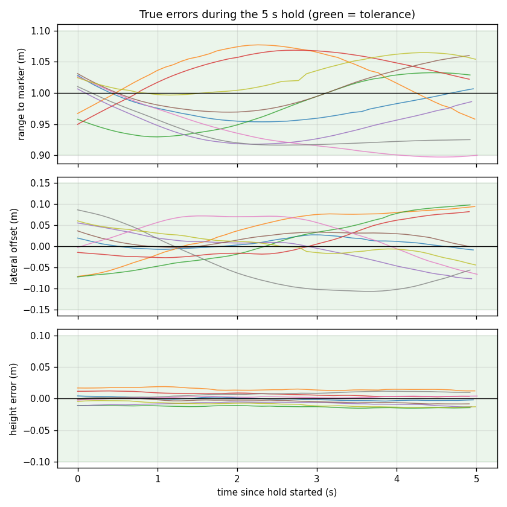
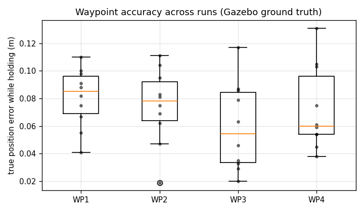

# Experiment experiment_main

10 runs of the full mission (waypoints → search → approach → 5 s hold at 1 m → land), each in a fresh headless sim. Wind 0.5–2.5 m/s random direction plus the world's gusts; GPS/baro noise on. Hold statistics are over each successful run's completed 5 s hold. Errors are measured against Gazebo ground truth.

**Success: 9/10**

| Run | OK | Wind | Duration (s) | Search (°) | Settle (s) | True range (m) | True lateral (m) | Note |
| --- | --- | --- | --- | --- | --- | --- | --- | --- |
| 1 | ✗ | 2.4 m/s @ 161° | None | 51.6 |  |  |  | approach timed out |
| 2 | ✓ | 0.6 m/s @ -149° | 84.0 | 51.7 | 12.1 | 0.977 | +0.007 |  |
| 3 | ✓ | 2.2 m/s @ 85° | 94.8 | 53.7 | 19.6 | 1.031 | +0.035 |  |
| 4 | ✓ | 1.8 m/s @ -69° | 87.8 | 54.3 | 19.2 | 0.978 | +0.010 |  |
| 5 | ✓ | 1.7 m/s @ 38° | 94.8 | 52.5 | 18.8 | 1.036 | +0.010 |  |
| 6 | ✓ | 1.7 m/s @ -123° | 94.8 | 50.1 | 18.5 | 0.948 | -0.006 |  |
| 7 | ✓ | 1.4 m/s @ -38° | 80.8 | 53.6 | 11.9 | 1.004 | +0.018 |  |
| 8 | ✓ | 1.9 m/s @ 178° | 94.8 | 54.3 | 23.1 | 0.937 | +0.029 |  |
| 9 | ✓ | 2.4 m/s @ 16° | 101.8 | 52.4 | 24.9 | 0.937 | -0.046 |  |
| 10 | ✓ | 1.4 m/s @ -83° | 80.8 | 54.7 | 12.1 | 1.028 | +0.006 |  |

## Waypoints (true position error)

| Waypoint | Target (m) | When the hold starts (settled) | Mean over the 2 s hold | End of hold | Drone's own estimate (mean over hold) |
| --- | --- | --- | --- | --- | --- |
| WP1 | (0, -3, 2) | 0.062 ± 0.026 m (max 0.094) | 0.081 ± 0.021 m (max 0.110) | 0.087 ± 0.029 m (max 0.133) | 0.075 ± 0.020 m (max 0.105) |
| WP2 | (-3, -3, 2.5) | 0.041 ± 0.023 m (max 0.085) | 0.075 ± 0.027 m (max 0.111) | 0.090 ± 0.025 m (max 0.128) | 0.066 ± 0.024 m (max 0.102) |
| WP3 | (-3, 0, 2) | 0.053 ± 0.022 m (max 0.085) | 0.059 ± 0.032 m (max 0.117) | 0.070 ± 0.039 m (max 0.127) | 0.056 ± 0.032 m (max 0.113) |
| WP4 | (1, 0, 1.5) | 0.049 ± 0.022 m (max 0.082) | 0.072 ± 0.030 m (max 0.131) | 0.079 ± 0.039 m (max 0.132) | 0.069 ± 0.026 m (max 0.122) |

## Marker hold (true, camera to marker, mean over each run's 5 s hold)

| Quantity | Tolerance | Mean ± std across runs (worst run) | Worst single sample |
| --- | --- | --- | --- |
| Range (target 1.00 m) | ±0.10 m | 0.986 ± 0.040 m (max 1.036) | 0.987 ± 0.078 m (max 1.077) |
| Lateral offset | ±0.15 m | 0.007 ± 0.023 m (max -0.046) | 0.032 ± 0.075 m (max -0.107) |
| Height error | ±0.10 m | -0.001 ± 0.009 m (max 0.015) | -0.000 ± 0.013 m (max 0.019) |
| Bearing | ±5° | -0.11 ± 0.47 ° (max 0.67) | -0.57 ± 1.26 ° (max -1.73) |

Drone's own range estimate during the hold: 0.996 ± 0.041 m (max 1.046) (vs true 0.986 ± 0.040 m (max 1.036)). Time from first sighting to settled: 17.8 ± 4.8 s (max 24.9). Hold restarts: 8.

