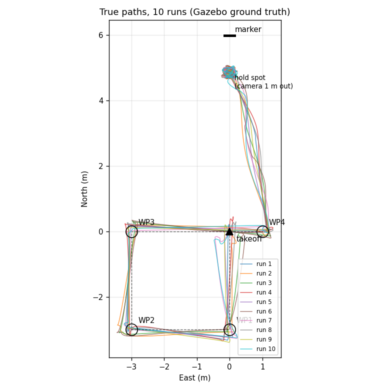
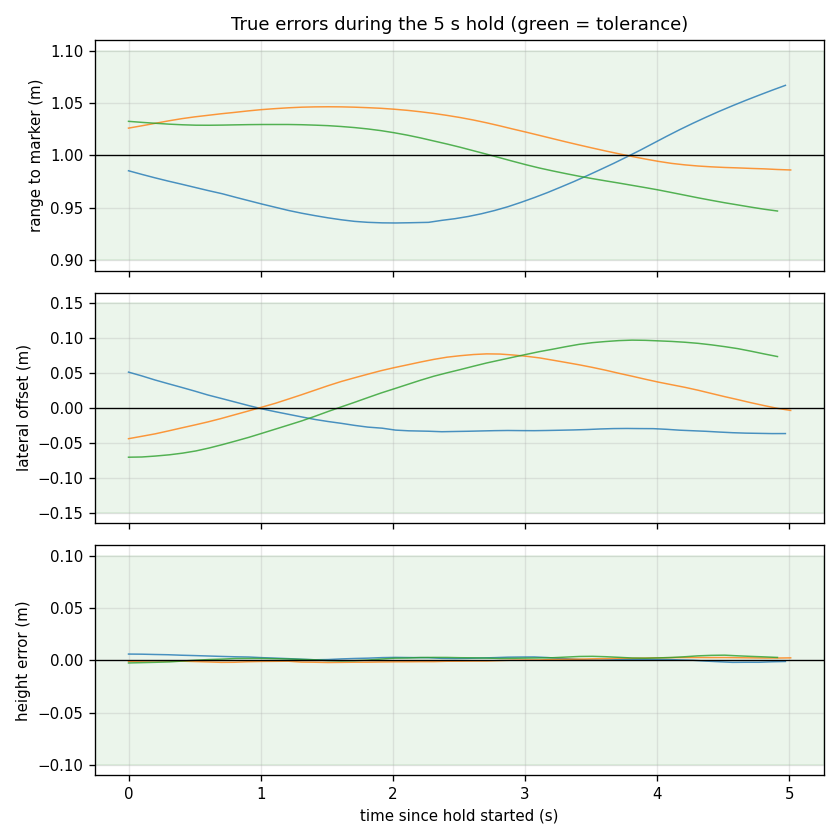
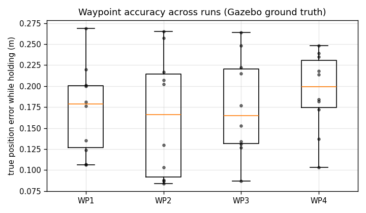

# Experiment experiment_p_only

10 runs of the full mission (waypoints → search → approach → 5 s hold at 1 m → land), each in a fresh headless sim. Wind 1.0–4.0 m/s random direction plus the world's gusts; GPS/baro noise on. Hold statistics are over each successful run's completed 5 s hold. Errors are measured against Gazebo ground truth.

**Success: 3/10**

| Run | OK | Wind | Duration (s) | Search (°) | Settle (s) | True range (m) | True lateral (m) | Note |
| --- | --- | --- | --- | --- | --- | --- | --- | --- |
| 1 | ✓ | 1.4 m/s @ 125° | 75.1 | 57.0 | 19.6 | 0.977 | -0.018 |  |
| 2 | ✗ | 3.3 m/s @ -88° | None | 53.6 |  |  |  | approach timed out |
| 3 | ✗ | 2.5 m/s @ -18° | None | 57.5 |  |  |  | approach timed out |
| 4 | ✗ | 3.0 m/s @ 104° | None | 55.4 |  |  |  | approach timed out |
| 5 | ✓ | 1.3 m/s @ -170° | 77.8 | 54.2 | 22.1 | 1.022 | +0.029 |  |
| 6 | ✗ | 3.5 m/s @ -24° | None | 58.3 |  |  |  | approach timed out |
| 7 | ✗ | 3.3 m/s @ -179° | None | 55.0 |  |  |  | approach timed out |
| 8 | ✗ | 2.3 m/s @ 80° | None | 57.0 |  |  |  | approach timed out |
| 9 | ✓ | 1.7 m/s @ 160° | 68.7 | 53.2 | 13.3 | 1.000 | +0.032 |  |
| 10 | ✗ | 3.7 m/s @ -169° | None | 55.1 |  |  |  | approach timed out |

## Waypoints (true position error)

| Waypoint | Target (m) | At arrival (tolerance 0.3) | Mean over the hold | End of hold | Drone's own estimate (mean over hold) |
| --- | --- | --- | --- | --- | --- |
| WP1 | (0, -3, 2) | 0.273 ± 0.023 m (max 0.313) | 0.172 ± 0.053 m (max 0.269) | 0.218 ± 0.093 m (max 0.348) | 0.169 ± 0.048 m (max 0.260) |
| WP2 | (-3, -3, 2.5) | 0.258 ± 0.028 m (max 0.312) | 0.164 ± 0.073 m (max 0.265) | 0.198 ± 0.102 m (max 0.328) | 0.163 ± 0.071 m (max 0.263) |
| WP3 | (-3, 0, 2) | 0.263 ± 0.032 m (max 0.307) | 0.176 ± 0.059 m (max 0.264) | 0.196 ± 0.091 m (max 0.313) | 0.176 ± 0.056 m (max 0.260) |
| WP4 | (1, 0, 1.5) | 0.253 ± 0.055 m (max 0.312) | 0.193 ± 0.047 m (max 0.248) | 0.242 ± 0.078 m (max 0.343) | 0.189 ± 0.044 m (max 0.237) |

## Marker hold (true, camera to marker, mean over each run's 5 s hold)

| Quantity | Tolerance | Mean ± std across runs (worst run) | Worst single sample |
| --- | --- | --- | --- |
| Range (target 1.00 m) | ±0.10 m | 1.000 ± 0.023 m (max 1.022) | 1.020 ± 0.064 m (max 1.067) |
| Lateral offset | ±0.15 m | 0.015 ± 0.028 m (max 0.032) | 0.075 ± 0.023 m (max 0.097) |
| Height error | ±0.10 m | 0.001 ± 0.001 m (max 0.002) | 0.004 ± 0.002 m (max 0.006) |
| Bearing | ±5° | 0.37 ± 1.29 ° (max 1.26) | 1.07 ± 3.02 ° (max 2.84) |

Drone's own range estimate during the hold: 1.009 ± 0.025 m (max 1.033) (vs true 1.000 ± 0.023 m (max 1.022)). Time from first sighting to settled: 18.3 ± 4.5 s (max 22.1). Hold restarts: 4.

